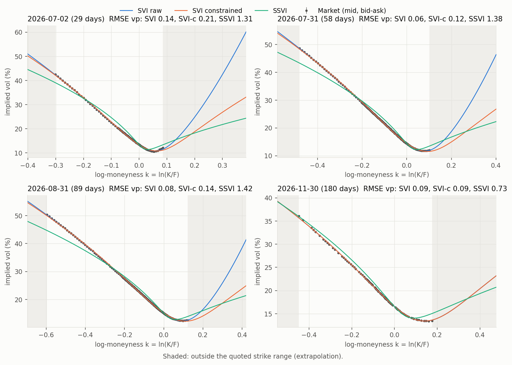
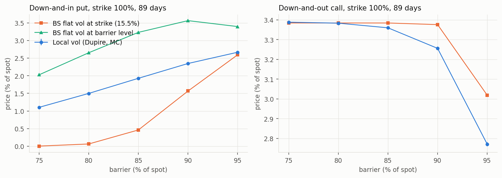
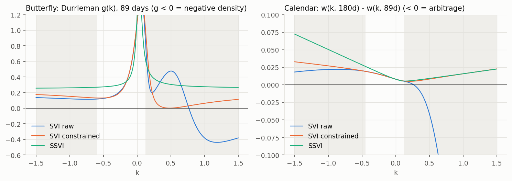
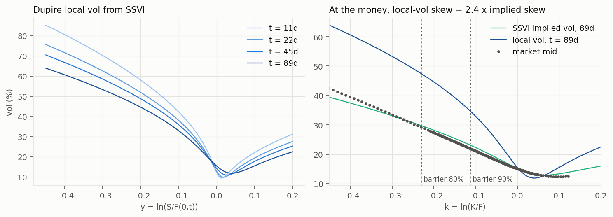

# Arbitrage-free implied volatility surfaces on SPY: SVI, SSVI, Dupire local vol and barrier pricing

[](https://github.com/tancredeg/volatility-surface-svi/actions/workflows/ci.yml)


**Calibrates the implied volatility surface of SPY options (raw SVI, SVI with static no-arbitrage constraints, and SSVI), audits it for butterfly and calendar arbitrage, then derives Dupire local volatility from the arbitrage-free SSVI surface to measure how much a flat-volatility desk misprices barrier options.**

Data: one frozen snapshot of listed SPY options on 2026-06-03 (4 expiries, 29 to 180 days, 1,215 quotes), Yahoo Finance.

## Key results

<!-- BEGIN:key-results -->
- **Fit.** On 680 out-of-the-money quotes, constrained (arbitrage-free) SVI has an implied-vol RMSE of 0.09-0.21 vol points per expiry, against 0.06-0.14 for unconstrained SVI and 0.73-1.42 for SSVI. Removing arbitrage costs at most 0.065 vol point per expiry; SSVI's single set of shape parameters for all expiries costs 0.64-1.34.
- **Arbitrage.** Unconstrained SVI shows butterfly arbitrage (negative density) on 3 of 4 expiries (g(k) as low as -0.44, at k = 0.95 to 1.19) and 1 of 3 pairs of expiries cross in total variance (for k >= 0.27); none of these violations lie inside the quoted strike range (k <= 0.18). The fit looks clean on the data and breaks in the extrapolated wings, which Dupire local vol and every wing-sensitive product use. Constrained SVI and SSVI have no violation, confirmed by two independent checks (Durrleman g and convexity of call prices in strike); the SSVI surface is arbitrage-free at every maturity, not only at the listed ones (gamma <= 1/2).
- **Speed.** A full surface takes 0.05 s with SSVI, 1.8 s with raw SVI and 3.4 s with constrained SVI (median, one CPU core).
- **Structuring.** On a down-and-in put expiring in 89 days (strike 100%, barrier 90%), Dupire local vol gives 2.35% of notional against 1.57% for Black-Scholes at the strike vol (15.5%): the flat-vol desk would under-charge the barrier by 0.78% of notional, i.e. overstate a reverse-convertible coupon by about 3.2% per annum. Using the barrier-level vol instead (23.0%) gives 3.56%.
- **Model check.** The local-vol Monte Carlo reprices the SSVI vanillas within 0.05 vol point (2.3 standard errors at most); SSVI itself is off the market by 1.17 vol point at the 90% strike, which bounds the precision of the barrier prices.
<!-- END:key-results -->

<!-- BEGIN:fit-table -->
| Expiry | T (days) | Quotes | ATM vol | RMSE SVI raw | RMSE SVI constrained | RMSE SSVI | Half bid-ask |
|---|---:|---:|---:|---:|---:|---:|---:|
| 2026-07-02 | 29 | 134 | 13.43% | 0.14 | 0.21 | 1.31 | 0.025 |
| 2026-07-31 | 58 | 217 | 14.40% | 0.06 | 0.12 | 1.38 | 0.019 |
| 2026-08-31 | 89 | 225 | 15.07% | 0.08 | 0.14 | 1.42 | 0.019 |
| 2026-11-30 | 180 | 104 | 16.54% | 0.09 | 0.09 | 0.73 | 0.021 |
<!-- END:fit-table -->

*Implied-vol RMSE in vol points (one vol point = 0.01 of implied volatility, e.g. 15% to 16%), same loss for every model. Half bid-ask is the median half-width of the quotes, in vol points.*





<details>
<summary><b>Arbitrage audit</b></summary>

<!-- BEGIN:arbitrage-table -->
| Model | Slices with g(k) < 0 | of which inside quoted range | Min g(k) | Negative-density points (price check) | Calendar crossings: quoted / extrapolated (grid points) |
|---|---:|---:|---:|---:|---:|
| SVI raw | 3 / 4 | 0 | -0.439 | 2398 | 0 / 1234 |
| SVI constrained | 0 / 4 | 0 | +0.000 | 0 | 0 / 0 |
| SSVI | 0 / 4 | 0 | +0.254 | 0 | 0 / 0 |
<!-- END:arbitrage-table -->

Butterfly arbitrage is checked on k = ln(K/F) in [-1.5, 1.5] with Durrleman's g(k) and, independently, with the convexity of Black-76 call prices in strike. Calendar arbitrage is a crossing of total-variance curves between consecutive expiries. Counts are grid points (3,001 points), split between the quoted strike range and the extrapolated wings.


</details>

<details>
<summary><b>Barrier options: local vol vs flat vol</b></summary>

Down-and-in put (DIP, the option an investor sells in a reverse convertible) and down-and-out call (DOC), strike 100% of spot, continuous monitoring, expiry 2026-08-31. Prices in % of spot. Local vol and flat vol use the same Monte-Carlo paths (400,000, antithetic, 4 steps per day, Brownian-bridge correction) and the same dividend-aware forward curve. "Coupon effect" converts the DIP gap into the annual coupon a reverse convertible would overstate.

"DIP BS barrier vol" is the closed form at the implied vol of the barrier level, with the continuous dividend yield equivalent to the forward; the Monte-Carlo prices use SPY's cash dividends instead, which moves flat-vol prices by up to 1%.

<!-- BEGIN:barrier-table -->
| Barrier | DIP local vol | DIP BS strike vol | DIP BS barrier vol | LV - BS(strike) | Coupon effect p.a. | DOC local vol | DOC BS strike vol | DOC gap |
|---:|---:|---:|---:|---:|---:|---:|---:|---:|
| 75% | 1.10% | 0.00% | 2.03% | +1.10% | +4.5% | 3.39% | 3.38% | +0.1% |
| 80% | 1.50% | 0.06% | 2.65% | +1.43% | +5.9% | 3.38% | 3.38% | -0.0% |
| 85% | 1.93% | 0.46% | 3.23% | +1.47% | +6.0% | 3.36% | 3.38% | -0.7% |
| 90% | 2.35% | 1.57% | 3.56% | +0.78% | +3.2% | 3.26% | 3.38% | -3.6% |
| 95% | 2.67% | 2.59% | 3.39% | +0.07% | +0.3% | 2.77% | 3.02% | -8.2% |
<!-- END:barrier-table -->

Check of the local-vol engine: vanillas priced by the same Monte Carlo against the SSVI surface it was built from, and against the market.

<!-- BEGIN:repricing-table -->
| Strike | Type | Market vol | SSVI vol | Local-vol MC implied vol | MC error (std errors) |
|---:|---|---:|---:|---:|---:|
| 80% | put | 29.16% | 29.73% | 29.71% | -0.2 |
| 90% | put | 21.88% | 23.04% | 23.07% | +0.4 |
| 100% | call | 15.42% | 15.53% | 15.58% | +2.3 |
| 110% | call | 12.41% | 13.12% | 13.15% | +1.0 |
<!-- END:repricing-table -->


</details>

<details>
<summary><b>Calibration time and stability</b></summary>

<!-- BEGIN:timing-table -->
| Model | Median time, full surface (s) | Per slice (ms) | Runs |
|---|---:|---:|---:|
| SVI raw | 1.81 | 453 | 10 |
| SVI constrained | 3.44 | 859 | 10 |
| SSVI | 0.05 | 14 | 10 |
<!-- END:timing-table -->

Stability: 50 recalibrations on quotes perturbed by N(0, 0.1 vol point²); standard deviation of the fitted vol, in vol points, worst expiry. Wings are extrapolated.

<!-- BEGIN:stability-table -->
| Model | Std ATM vol | Std put wing k=-0.5 | Std call wing k=+0.3 | Fits at a bound |
|---|---:|---:|---:|---:|
| SVI raw | 0.018 | 0.126 | 0.716 | 0 |
| SVI constrained | 0.016 | 0.108 | 0.418 | 0 |
| SSVI | 0.075 | 0.095 | 0.062 | 0 |
<!-- END:stability-table -->
</details>

## Methodology

**Data and conventions** ([data/README.md](data/README.md)). Mid prices of two-sided quotes only, never last-trade prices. Time to expiry ACT/365 from the snapshot time to 16:00 New York. One forward per expiry from put-call parity on near-the-money strikes; Black-76 implied vols on that forward, so spot, rate and dividend yield drop out. Discounting at the 3-month T-bill rate of the day (FRED DTB3). Out-of-the-money options only, filtered on minimum bid, delta (|Δ| ≥ 0.5%) and bid-ask width (≤ 1 vol point).

**Models.** In log-moneyness k = ln(K/F) and total implied variance w = σ²T:

* *Raw SVI* (Gatheral 2004), one slice per expiry: w(k) = a + b[ρ(k − m) + √((k − m)² + σ²)]. Fitted by least squares on implied vol, started from a quasi-explicit grid (Zeliade 2009).
* *Constrained SVI*: same fit under static no-arbitrage. Durrleman's g(k) = (1 − k w′/2w)² − (w′²/4)(1/w + 1/4) + w″/2 ≥ 0 on a grid (non-negative density), Lee's wing bound b(1 ± ρ) ≤ 2, w ≥ 0, and w(k, Tᵢ) ≥ w(k, Tᵢ₋₁) (no calendar spread). Solved by a penalty continuation followed by SLSQP; feasibility re-checked on a 10x finer grid.
* *SSVI* (Gatheral & Jacquier 2014): w(k, θ) = θ/2 [1 + ρφk + √((φk + ρ)² + 1 − ρ²)], φ(θ) = η / (θ^γ (1 + θ)^(1−γ)). θ_t is pinned to the market ATM total variance of each expiry and interpolated in time by a monotone spline through (0, 0); (ρ, η, γ) are global. With γ ≤ 1/2 and η at most the exact bound implied by Theorem 4.2 for every θ > 0, the surface is free of static arbitrage at every maturity, including t → 0, which Dupire needs.

**Local volatility.** Gatheral's form of Dupire: σ²_loc(y, T) = ∂_T w / g(y), with y = ln(K/F(0, T)). On SSVI, ∂_T w = (∂w/∂θ) θ′(T) ≥ 0 and g > 0, so the local variance is positive everywhere by construction.

**Barrier pricing.** Y_t = ln(S_t / F(0, t)) is simulated under local vol with antithetic normals and a log-Euler scheme; continuous monitoring uses the exact Brownian-bridge crossing probability between grid dates. The forward curve carries SPY's two cash dividends (ex-dates 2026-06-18 and 2026-09-18) with the spot implied from the parity forward. Flat-vol prices use the same engine; the closed forms of Reiner & Rubinstein (1991) are cross-checked against QuantLib in the tests.

**Limits (what this does not do).**

* One snapshot of delayed retail quotes (Yahoo), not a time series of exchange data: the results describe one day, not a statistical property.
* SPY options are American; they are priced as European. Using out-of-the-money options only keeps the early-exercise premium small, but it is not modelled.
* Flat discount curve (one T-bill rate) and cash dividends known in advance; dividends enter the local-vol dynamics proportionally to the spot (the forward jumps, the vol surface does not).
* SSVI has one correlation ρ for all expiries, so it misses the steeper short-dated skew (RMSE of 1.3-1.4 vol points on the three shorter expiries, 1.2 vol points off the market at the 90% strike); the local vol and the barrier prices inherit this. Extended SSVI (ρ depending on θ, Hendriks & Martini 2019) would fix it and is not implemented.
* Local vol prices barriers with today's smile frozen in the forward dynamics; it ignores the stochastic-vol component that a desk would add (local-stochastic vol).
* Raw quotes are not redistributed: anyone can rerun the full pipeline on the bundled synthetic chain; the README numbers on the real chain are reproducible by anyone holding the file with the pinned SHA-256.

## Reproduce

```
pip install -e .
python scripts/run_results.py
```

This runs the whole study on the bundled SPY-like sample and writes every table and figure to `results/sample/` and `figures/sample/` (about 3 minutes on one core; `--fast` for a quick smoke run). With the raw chain in `data/raw/`, `python scripts/run_results.py --snapshot data/snapshots/spy_20260603.json --update-readme` regenerates `results/real/`, `figures/real/` and every number above. Tests: `pip install -e .[dev,crosscheck]` then `pytest`. Demo notebook: [notebooks/demo.ipynb](notebooks/demo.ipynb).

## Code structure

```
src/volsurf/
  data.py       snapshot metadata, chain loading, cleaning filters
  forward.py    T-bill rate conversion, put-call-parity forwards, dividend-aware forward curve
  iv.py         Black-76 prices, vega, delta, vectorised implied vol
  svi.py        raw SVI, Durrleman g, unconstrained and constrained calibration
  ssvi.py       SSVI with power-law phi, Theorem 4.1/4.2 conditions, theta curve, calibration
  arbitrage.py  butterfly and calendar audits (g, price convexity, crossings)
  localvol.py   Dupire local variance from total implied variance
  barrier.py    Reiner-Rubinstein closed forms, local-vol Monte Carlo with Brownian bridge
  pipeline.py   end-to-end study: fit, arbitrage, timing, stability, barriers
  report.py     JSON/CSV outputs and the README tables
  plots.py      figures
scripts/        run_results.py, make_sample.py, fetch_data.py, audit/ (v0 audit)
tests/          70+ tests: financial identities, known counterexamples, parameter recovery,
                QuantLib cross-checks, regression on the sample and on the real snapshot
data/           snapshot metadata, synthetic sample (raw quotes stay local)
results/, figures/   outputs of scripts/run_results.py
```

Project history: v0 of this repository published numbers computed from stale last-trade prices with an inactive butterfly constraint; the audit that led to this rebuild is in [AUDIT.md](AUDIT.md) (in French), progress notes in [PROGRESS.md](PROGRESS.md).

## References

* Black, F. (1976). The pricing of commodity contracts. *Journal of Financial Economics*, 3, 167-179.
* Breeden, D. & Litzenberger, R. (1978). Prices of state-contingent claims implicit in option prices. *Journal of Business*, 51(4), 621-651.
* Dupire, B. (1994). Pricing with a smile. *Risk*, 7(1), 18-20.
* Gatheral, J. (2004). A parsimonious arbitrage-free implied volatility parametrization with application to the valuation of volatility derivatives. Global Derivatives & Risk Management, Madrid.
* Gatheral, J. (2006). *The Volatility Surface: A Practitioner's Guide*. Wiley.
* Gatheral, J. & Jacquier, A. (2014). Arbitrage-free SVI volatility surfaces. *Quantitative Finance*, 14(1), 59-71. arXiv:1204.0646.
* Glasserman, P. (2003). *Monte Carlo Methods in Financial Engineering*. Springer.
* Haug, E. G. (2007). *The Complete Guide to Option Pricing Formulas*, 2nd ed. McGraw-Hill.
* Hendriks, S. & Martini, C. (2019). The extended SSVI volatility surface. *Journal of Computational Finance*, 22(5).
* Lee, R. (2004). The moment formula for implied volatility at extreme strikes. *Mathematical Finance*, 14(3), 469-480.
* Reiner, E. & Rubinstein, M. (1991). Breaking down the barriers. *Risk*, 4(8), 28-35.
* Zeliade Systems (2009). Quasi-explicit calibration of Gatheral's SVI model. Zeliade white paper.

## License

MIT, see [LICENSE](LICENSE).
